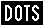
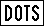

<!--
SPDX-License-Identifier: CC-BY-4.0
Copyright (c) 2026 Pawel Pajor
-->

# DOTS
Dots On Tiny Surfaces

> *One day Trurl the constructor put together a machine that could build*
> *anything beginning with the letter 'n'.*
>
> -- Stanislaw Lem, _The Cyberiad_ (trans. Michael Kandel)

DOTS is a small format for animated pictures: a grid of cells, eight
dots in each, switching on and off from one frame to the next,
optionally with annotations on top, as text (UTF-8).

## The idea

The aim is to help people connect through machines as different as a
terminal, a tiny display and a Braille tablet. A DOTS cell, eight dots
in two columns of four, is exactly the shape of an eight-dot Braille
cell, so the same picture can be lit pixels on one screen and raised
dots on another.

It might be used for:

- Animations in a terminal, drawn with Braille characters.
- Games with maps and labels.
- Pixel art and ASCII art.
- Shared notes and boards that many people can look at.
- Status panels that can say what they mean.
- Code adorned by illustrations.

## Minimal

DOTS is designed to use a minuscule fraction of your machine resources.
But being light is not the main point. The main point is the look: a
grid of dots, a style of its own.

## Where to look

The details are in the specification, which has two parts:
[dots-binary.md](dots-binary.md) covers the layout of a stream, and
[dots-content.md](dots-content.md) covers what it carries and how
dots and text combine.

A few small example streams, each illustrating a specific point of the
specification, are listed [here](examples/README.md).

Logo can be found [here](logo/README.md).

## License and governance

The documents are licensed under CC BY 4.0, see [LICENSE](LICENSE).
[GOVERNANCE.md](GOVERNANCE.md) says how DOTS is developed and what may
be called DOTS.

 